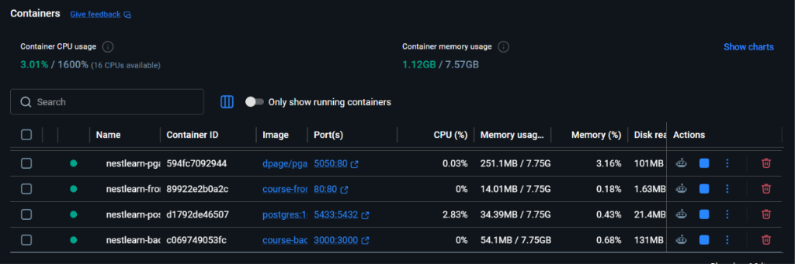
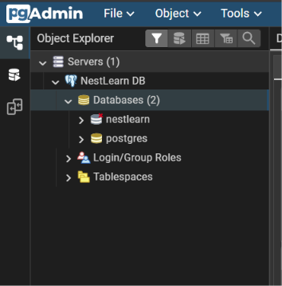

# E-Commerce & Reviews DevOps Project

A full-stack, enterprise-grade web application built to fulfill all DevOps and Software Engineering requirements.

---

## Project Requirements Checklist

| Lot / Requirement | Implementation Details | Status |
| :--- | :--- | :---: |
| **Web Interface (Frontend)** | React 19 + TypeScript + Vite (`frontend/`) | Completed |
| **Backend API** | NestJS REST API + TypeORM + Swagger documentation (`src/`) | Completed |
| **Database Tier** | PostgreSQL 16 Alpine + pgAdmin 4 management (`db/`, `docker-compose.yml`) | Completed |
| **Authentication & RBAC** | JWT authentication, bcrypt hashing, role guards (`admin` & `user`) | Completed |
| **Business Feature 1** | **Product Catalog**: Search, price filtering, admin CRUD, detail view | Completed |
| **Business Feature 2** | **Product Reviews**: 1–5 star ratings, feedback comments, ownership rules | Completed |
| **Automated Testing & Quality** | 71 unit tests in Jest; ESLint 9 code quality with 0 errors | Completed |
| **Containerization (Lot 4)** | Multi-stage backend & frontend Dockerfiles; Docker Compose 4-tier stack | Completed |
| **CI/CD Pipeline (Lot 5)** | Automated Jenkins Declarative Pipeline with build, test, archive & deploy | Completed |

---

## Architecture Overview

```
devops/course/
├── src/                          # NestJS Backend API
│   ├── users/                    # Authentication, Roles & Profile Management
│   ├── products/                 # Product Catalog & Management
│   ├── reviews/                  # Reviews & Rating System
│   ├── orders/                   # Orders & Cart Management
│   ├── favorites/                # User Wishlist / Favorites
│   ├── uploads/                  # Profile image upload module
│   └── mail/                     # Email notification module
├── frontend/                     # React 19 + TypeScript + Vite Web App
│   ├── src/pages/                # Login, Register, Products, ProductDetail, Profile
│   ├── Dockerfile                # Multi-stage build with Nginx SPA server
│   └── nginx.conf / default.conf # SPA client routing configuration
├── db/                           # TypeORM data source, migrations & seeders
├── Dockerfile                    # Multi-stage NestJS production Dockerfile
├── docker-compose.yml            # Multi-container orchestration (4 services)
├── Jenkinsfile                   # Declarative CI/CD pipeline definition
└── test/                         # End-to-end test suites
```

---

## Lot 4: Containerization (Docker & Docker Compose)

The entire application runs in isolated, networked containers via Docker Compose:

```
                            +-----------------------------------------+
                            |              Docker Network             |
                            |                                         |
    Browser (Port 80) ----->|  nestlearn-frontend (Nginx Alpine)      |
                            |                                         |
    Browser (Port 3000) --->|  nestlearn-backend  (Node 20 Alpine)    |
                            |       |                                 |
                            |       v                                 |
    Browser (Port 5050) --->|  nestlearn-pgadmin  (pgAdmin 4)         |
                            |       |                                 |
                            |       v                                 |
    Host (Port 5433) ------>|  nestlearn-postgres (Postgres 16 Alpine)|
                            +-----------------------------------------+
```

### 1. Services Configuration

| Service Name | Container Name | Port Mapping | Image / Build Target | Role |
| :--- | :--- | :--- | :--- | :--- |
| **`frontend`** | `nestlearn-frontend` | `80:80` | `frontend/Dockerfile` (Nginx) | Web UI served with SPA routing |
| **`backend`** | `nestlearn-backend` | `3000:3000` | `./Dockerfile` (Node 20 Alpine) | NestJS REST API & Swagger |
| **`db`** | `nestlearn-postgres` | `5433:5432` | `postgres:16-alpine` | PostgreSQL database with healthcheck |
| **`pgadmin`** | `nestlearn-pgadmin` | `5050:80` | `dpage/pgadmin4:latest` | Web-based database management GUI |

### 2. Verified Running Containers (`docker ps`)

```bash
$ docker ps --format "table {{.Names}}\t{{.Image}}\t{{.Status}}\t{{.Ports}}"
NAMES                 IMAGE                   STATUS                   PORTS
nestlearn-frontend    course-frontend         Up 25 minutes            0.0.0.0:80->80/tcp
nestlearn-backend     course-backend          Up 20 minutes            0.0.0.0:3000->3000/tcp
nestlearn-postgres    postgres:16-alpine      Up 30 minutes (healthy)  0.0.0.0:5433->5432/tcp
nestlearn-pgadmin     dpage/pgadmin4:latest   Up 30 minutes            0.0.0.0:5050->80/tcp
```

#### Docker Desktop Verification:


---

## Database Management & pgAdmin Dashboard

### pgAdmin Configuration
- **Portal URL**: [http://localhost:5050](http://localhost:5050)
- **Login Credentials**: `admin@admin.com` / `admin`
- **Registered Server Connection**:
  - **Host**: `db` (or `nestlearn-postgres`)
  - **Port**: `5432`
  - **Maintenance DB**: `postgres`
  - **User**: `postgres`
  - **Password**: `admin`

#### pgAdmin Dashboard & Server Tree:


### Seeding Initial Data
To populate users, products, and reviews into PostgreSQL:
```powershell
npm run db:seed
```
To verify the populated database content in table format:
```powershell
npm run db:view
```

---

## Lot 5: Jenkins CI/CD Pipeline

The automated Jenkins pipeline is defined in [`Jenkinsfile`](Jenkinsfile) and includes 8 stages:

```groovy
pipeline {
    agent any
    tools {
        nodejs 'NodeJS24'
    }
    stages {
        stage('Checkout') {
            steps { checkout scm }
        }
        stage('Install Dependencies') {
            steps {
                sh 'npm ci'
                dir('frontend') { sh 'npm ci' }
            }
        }
        stage('Quality & Linting') {
            steps {
                sh 'npm run lint'
                dir('frontend') { sh 'npm run lint' }
            }
        }
        stage('Testing') {
            steps {
                sh 'npx jest --runInBand'
            }
        }
        stage('Build Backend (NestJS)') {
            steps { sh 'npm run build' }
        }
        stage('Build Frontend (React Vite)') {
            steps { dir('frontend') { sh 'npm run build' } }
        }
        stage('Archive Artifacts') {
            steps {
                archiveArtifacts artifacts: 'dist/**, frontend/dist/**', allowEmptyArchive: false
            }
        }
        stage('Deploy Application') {
            steps {
                sh 'docker compose up -d --build'
            }
        }
    }
}
```

### Pipeline Stages Summary

| Stage | Purpose | Output / Result |
| :--- | :--- | :--- |
| **Checkout** | Pulls source code from Git SCM | Source repository checked out |
| **Install Dependencies** | Installs backend and frontend dependencies cleanly | Node modules resolved |
| **Quality & Linting** | Runs ESLint and TypeScript checks across all tiers | 0 linting errors or warnings |
| **Testing** | Runs the automated Jest test suite | 71/71 tests passing |
| **Build Backend** | Compiles NestJS TypeScript into production bundle | Emits `dist/` |
| **Build Frontend** | Compiles React 19 + TypeScript + Vite | Emits `frontend/dist/` |
| **Archive Artifacts** | Persists production build artifacts in Jenkins | Stored in build artifacts |
| **Deploy Application** | Automatically deploys containers via Docker Compose | Containers rebuilt and deployed |

---

## Quick Start Guide

### Start the Application with Docker Compose:
```powershell
docker compose up -d --build
```

### Access Application Endpoints te:
- **Frontend Web UI**: [http://localhost](http://localhost) (Port 80)
- **Backend API**: [http://localhost:3000/api](http://localhost:3000/api)
- **Swagger API Documentation**: [http://localhost:3000/swagger](http://localhost:3000/swagger)
- **pgAdmin 4**: [http://localhost:5050](http://localhost:5050)

### Running Automated Tests Locally:
```powershell
# Run all 71 unit tests
npm test

# Run tests with coverage
npm run test:cov

# Run linter verification
npm run lint
```
