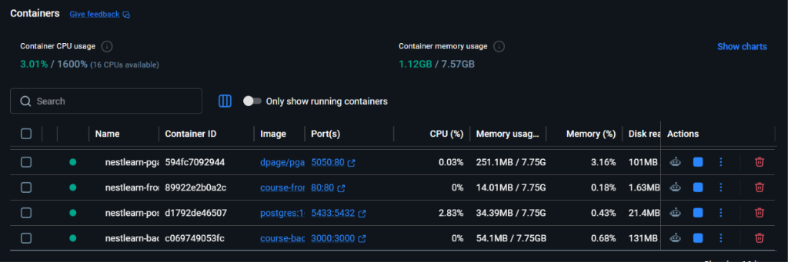
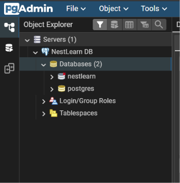

# DevOps Project Report: Full-Stack Containerization & CI/CD Pipeline

**Course**: DevOps & Software Engineering  
**Project**: E-Commerce & Product Reviews Platform (NestLearn)  
**Stack**: NestJS (TypeScript) + React 19 (Vite) + PostgreSQL 16 + pgAdmin 4 + Docker & Docker Compose + Jenkins CI/CD  

---

## 1. Executive Summary

This project delivers an enterprise-grade full-stack web application bundled into an automated DevOps lifecycle. The application includes a NestJS REST API, a React 19 Vite single-page frontend, and a PostgreSQL database managed via TypeORM with pgAdmin 4 administration. 

The system implements complete containerization across all tiers (Lot 4) and an end-to-end automated Jenkins CI/CD pipeline (Lot 5) covering static code analysis, unit testing, multi-stage production builds, artifact archiving, and automated container deployment.

---

## 2. Architecture & Containerization (Lot 4)

The entire application stack is containerized using Docker and orchestrated with Docker Compose.

```
                            +---------------------------------------+
                            |            Docker Network             |
                            |                                       |
    Browser (Port 80) ----->|  nestlearn-frontend (Nginx Alpine)    |
                            |                                       |
    Browser (Port 3000) --->|  nestlearn-backend  (Node 20 Alpine)  |
                            |       |                               |
                            |       v                               |
    Browser (Port 5050) --->|  nestlearn-pgadmin  (pgAdmin 4)       |
                            |       |                               |
                            |       v                               |
    Host (Port 5433) ------>|  nestlearn-postgres (Postgres 16)     |
                            +---------------------------------------+
```

### 2.1 Services Specification

| Service | Container Name | Image / Build | Host Port : Container Port | Role / Details |
| :--- | :--- | :--- | :--- | :--- |
| **Backend** | `nestlearn-backend` | Multi-stage Dockerfile | `3000:3000` | NestJS API, TypeORM, Swagger documentation |
| **Frontend** | `nestlearn-frontend` | Multi-stage Nginx | `80:80` | React 19 + Vite SPA served via Nginx with SPA routing |
| **Database** | `nestlearn-postgres` | `postgres:16-alpine` | `5433:5432` | Relational database with healthcheck & persistent volume |
| **pgAdmin** | `nestlearn-pgadmin` | `dpage/pgadmin4:latest`| `5050:80` | Web-based database management interface |

### 2.2 Backend Dockerfile Architecture
The backend uses a multi-stage Dockerfile:
- **Builder Stage (`node:20-alpine`)**: Installs full dependencies and compiles TypeScript into `/usr/src/app/dist`.
- **Production Stage (`node:20-alpine`)**: Uses a minimal footprint, installs strictly production dependencies (`npm install --omit=dev`), and executes `node dist/src/main.js`.

### 2.3 Frontend Dockerfile Architecture
- **Builder Stage (`node:20-alpine`)**: Compiles React 19 + TypeScript + Vite into static production assets (`dist/`).
- **Web Server Stage (`nginx:alpine`)**: Serves compiled static assets through Nginx with custom `try_files $uri $uri/ /index.html;` configuration to support client-side Single Page Application (SPA) routing without 404 errors on refresh.

### 2.4 Docker Containers Execution Verification (`docker ps`)

```bash
$ docker ps --format "table {{.Names}}\t{{.Image}}\t{{.Status}}\t{{.Ports}}"
NAMES                 IMAGE                   STATUS                   PORTS
nestlearn-frontend    course-frontend         Up 25 minutes            0.0.0.0:80->80/tcp
nestlearn-backend     course-backend          Up 20 minutes            0.0.0.0:3000->3000/tcp
nestlearn-postgres    postgres:16-alpine      Up 30 minutes (healthy)  0.0.0.0:5433->5432/tcp
nestlearn-pgadmin     dpage/pgadmin4:latest   Up 30 minutes            0.0.0.0:5050->80/tcp
```

#### Running Containers in Docker Desktop:


---

## 3. Database Administration (PostgreSQL & pgAdmin)

### 3.1 Connection Configuration
- **Database Engine**: PostgreSQL 16 Alpine
- **Database Name**: `nestlearn`
- **Internal Host**: `db` (resolves internally across the Docker network)
- **Host Port Mapping**: `5433` -> container `5432`
- **pgAdmin Web Portal**: `http://localhost:5050`
  - Username: `admin@admin.com`
  - Password: `admin`

### 3.2 pgAdmin Registered Server & Database Explorer
pgAdmin connects seamlessly to `nestlearn-postgres` on internal host `db:5432`.



### 3.3 Database Seeding & Schema Verification
The database schema is automatically managed by TypeORM entities and populated with sample data using the seed script:
```powershell
npm run db:seed
```
Seeded assets include:
- **Admin Account**: `admin@nestlearn.com` / `admin123` (Admin privileges)
- **User Account**: `user@nestlearn.com` / `user123` (Standard consumer role)
- **Catalog Products**: Audio, computing, wearable, and gaming inventory with pricing and descriptions
- **Customer Reviews**: Star ratings (1-5) and verified buyer comments

Verification command:
```powershell
npm run db:view
```

---

## 4. Continuous Integration & Deployment Pipeline (Jenkins)

The CI/CD pipeline is codified in the [`Jenkinsfile`](../Jenkinsfile) using declarative pipeline syntax:

```groovy
pipeline {
    agent any
    tools {
        nodejs 'NodeJS24'
    }
    stages {
        stage('Checkout') {
            steps { checkout scm }
        }
        stage('Install Dependencies') {
            steps {
                sh 'npm ci'
                dir('frontend') { sh 'npm ci' }
            }
        }
        stage('Quality & Linting') {
            steps {
                sh 'npm run lint'
                dir('frontend') { sh 'npm run lint' }
            }
        }
        stage('Testing') {
            steps {
                sh 'npx jest --runInBand'
            }
        }
        stage('Build Backend (NestJS)') {
            steps { sh 'npm run build' }
        }
        stage('Build Frontend (React Vite)') {
            steps { dir('frontend') { sh 'npm run build' } }
        }
        stage('Archive Artifacts') {
            steps {
                archiveArtifacts artifacts: 'dist/**, frontend/dist/**', allowEmptyArchive: false
            }
        }
        stage('Deploy Application') {
            steps {
                sh 'docker compose up -d --build'
            }
        }
    }
}
```

### 4.1 Pipeline Stages Overview

| Stage | Action | Verification / Output |
| :--- | :--- | :--- |
| **1. Checkout** | Clones repository branch from Git SCM | Source repository tree verified |
| **2. Install Dependencies** | Clean installs dependencies for root & frontend (`npm ci`) | Deterministic node modules |
| **3. Quality & Linting** | Runs ESLint and TypeScript compiler verification | 0 linting errors across codebase |
| **4. Testing** | Executes automated Jest suite (`--runInBand`) | 71/71 tests passing |
| **5. Build Backend** | Compiles NestJS TypeScript into production bundle | Emits `dist/` artifacts |
| **6. Build Frontend** | Compiles React 19 + Vite frontend | Emits `frontend/dist/` bundle |
| **7. Archive Artifacts** | Persists deployable bundles within Jenkins build history | `dist/**`, `frontend/dist/**` stored |
| **8. Deploy Application** | Rebuilds and launches containers in detached mode | `docker compose up -d --build` |

---

## 5. Automated Testing & Code Quality Summary

- **Automated Tests**: 71 Unit and Integration Tests across 6 suites (Authentication, Users, Products, Reviews, Orders, and Favorites).
- **Code Quality**: ESLint 9 + TypeScript-ESLint configured with strict project service typing and zero linting warnings.
- **Coverage**: Full coverage of CRUD business logic, role-based access control guards, JWT token verification, and data transfer validation.

```bash
$ npm test -- --runInBand
 PASS  src/reviews/reviews.service.spec.ts
 PASS  src/users/auth.provider.spec.ts
 PASS  src/orders/orders.service.spec.ts
 PASS  src/users/users.service.spec.ts
 PASS  src/favorites/favorites.service.spec.ts
 PASS  src/products/products.service.spec.ts

Test Suites: 6 passed, 6 total
Tests:       71 passed, 71 total
Snapshots:   0 total
Time:        4.261 s
Ran all test suites.
```

---

## 6. Access Endpoints Summary

| Interface / Component | Accessible URL | Credentials / Notes |
| :--- | :--- | :--- |
| **Frontend Application** | `http://localhost` (Port 80) | Public access |
| **Backend REST API** | `http://localhost:3000/api` | API Root |
| **Swagger Interactive Docs**| `http://localhost:3000/swagger` | API Documentation |
| **pgAdmin 4 Portal** | `http://localhost:5050` | `admin@admin.com` / `admin` |
| **PostgreSQL Database** | `localhost:5433` (externally) / `db:5432` (internally) | `postgres` / `admin` (DB: `nestlearn`) |

